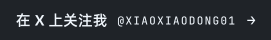

独立开发者。写作、配色、排版、出国上网，这些事我都踩过坑。踩完就写下来，做成免费开源的工具，你的 AI 照着就能做好。 
Independent maker. Writing, color, layout, getting online abroad: I have tripped over all of it. Each time I write the fix down as a free, open-source tool your AI can follow.

## 小小东 VPS

<b>出差到上网不方便的地方，常用的网站和 AI 照样能用。</b>买台海外服务器，剩下的交给 Codex 远程配好。服务器你一次都不用登录，手机和电脑导入一个订阅就能上网。 
<b>Travel somewhere the internet is locked down, and keep every site and AI tool you use.</b> Buy an overseas server and let Codex set it up remotely. You never log into it. Import one subscription on your phone and laptop and you are online.

 

## 中华传统色

<b>742 种中华传统色，不光好看，还拿来就能用。</b>每个颜色都有高清色卡、8,904 组配色和真实场景预览，还能直接导出 shadcn 主题和终端配色。 
<b>742 Chinese traditional colors, made to be used, not just admired.</b> Each one comes with a full-size card, 8,904 pairings and real-scene previews, plus shadcn themes and terminal palettes ready to export.

 

## 350 种排版

<b>排版没灵感的时候，翻翻这 350 张。</b>从三分法到网页 UI，分成 8 类 33 个主题。每张都是高清大图，能搜，能下载。 
<b>Out of layout ideas? Flip through these 350.</b> From the rule of thirds to web UI, sorted into 8 families and 33 themes. Every one is a full-size image you can search and download.

 

## pstack 新手教程

<b>AI 说「修好了」，你一打开，还是坏的。</b>pstack 让它改完先自己试一遍。这份教程用大白话讲，3 节课、20 分钟上手，只用记一个命令。 
<b>Your AI says “fixed”. You open it. Still broken.</b> pstack makes it test its own work first. This guide explains it in plain words: three lessons, 20 minutes, one command to remember.

 

## xxd-strip-ai-meta

<b>图片里藏着「AI 生成」的标记，一条命令批量清掉。</b>C2PA、EXIF、XMP 这些元数据都能清，像素一点不动。画面上看得见的水印它管不了，这点先说清楚。 
<b>Your images carry hidden “made with AI” tags. One command clears them in bulk.</b> C2PA, EXIF, XMP and the rest go, and the pixels stay untouched. Visible watermarks are out of its reach, to be clear.

 

## Rime 品牌选中色

<b>打字时那个选中块，换成你喜欢的品牌色。</b>蒂芙尼蓝、爱马仕橙、克莱因蓝，20 套品牌原色，每套都有浅色和夜色。复制一段话给 AI，它就帮你装好。 
<b>Give the highlight you type into a brand color you love.</b> Tiffany blue, Hermès orange, Klein blue: 20 schemes in their published colors, each in light and night. Paste one prompt to your AI and it installs them.

 

## 更多 · More

- [XXD Panel 视觉系列](https://github.com/nevertoday?tab=repositories&q=xxd-panel) 从照片出发的 AI 视觉 Skills · photo-led visual Skills
- [ghostty-tint](https://github.com/nevertoday/ghostty-tint) 每个 Ghostty 面板一种安静的颜色 · a quiet color for every Ghostty pane
- [mihomo-forge](https://github.com/nevertoday/mihomo-forge) 在浏览器里合并多份 Mihomo 配置 · merge Mihomo configs in the browser
- [xxd-chrome-publish](https://github.com/nevertoday/xxd-chrome-publish) 一条命令发布 Chrome 插件更新 · ship Chrome extension updates in one command
- [dsh-theme-plugin](https://github.com/nevertoday/dsh-theme-plugin) DeepSeek Harness 中华传统色主题 · Chinese traditional colors for DeepSeek Harness
- [xxd-notify](https://github.com/nevertoday/xxd-notify) 用 Bark 把任务提醒推到手机 · task alerts to your phone through Bark
- [xiaoxiaodong](https://github.com/nevertoday/xiaoxiaodong) 小小东项目入口 · where all of it starts

 

微信 / WeChat <code>newbe2012</code>

