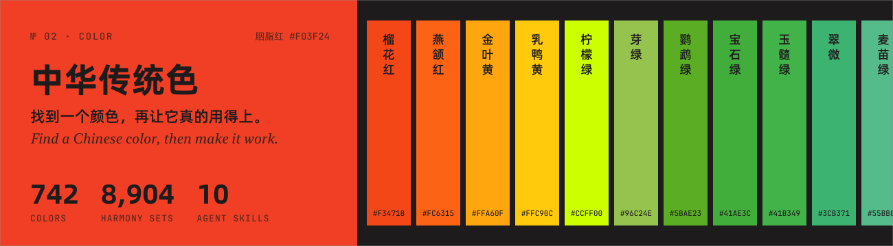

<b>独立开发者。把写作、视觉、配色、排版和出门上网这些事里攒下的经验，做成免费开源、AI 照着就能做的工具。</b> 
<b>Independent maker. I turn what I have learned about writing, visuals, color, layout and staying online abroad into free, open-source tools an AI can follow.</b>

## 小小东 VPS

<b>出差到上网不方便的国家，常用网站和 AI 工具也能照常用。</b>在自己电脑上装好 Codex，买一台海外服务器，让 Codex 按这套方案远程配好，手机和电脑导入订阅就能用。服务器上什么都不用装，也不用登录它。主、备两个节点自动切换，证书、规则和 CLIProxyAPI 自动更新，配置每天备份。 
<b>Travel somewhere the internet is restricted and keep using the sites and AI tools you rely on.</b> Install Codex on your computer, buy an overseas server, and let Codex set it up remotely from this plan. Import one subscription on your phone and computer and you are online. Nothing to install or log into on the server. Two nodes fail over to each other, and certificates, rules and CLIProxyAPI update themselves.

## 中华传统色

<b>742 种中华传统色，从找到颜色，到搭配、试用、落地。</b>每个颜色一张高清色卡，附 8,904 组配色关系、真实场景预览、shadcn 主题和终端配色。另有 10 个 Agent Skills，把配色流程带进 Claude Code。 
<b>742 Chinese traditional colors, from finding one to pairing, testing and shipping it.</b> A high-resolution card for every color, 8,904 harmony sets, real-scene previews, shadcn themes and terminal palettes. Ten Agent Skills bring the same workflow into Claude Code.

## 350 种排版

<b>从经典构图到网页 UI，350 种排版分好类，能浏览、能搜索、能下载。</b>覆盖构图逻辑、视觉原则、出版广告、字体网格、网页 UI、影视画面、中国传统构图和演示文稿，共 8 个一级分类、33 个二级主题。每张都有 1086 × 1448 高清图，附 CSV 和 JSON 目录。 
<b>350 layout compositions, from classic composition rules to web UI, ready to browse, search and download.</b> Eight categories and 33 themes cover composition logic, visual principles, editorial and advertising, type and grids, web UI, film frames, Chinese composition and presentations. Every image comes at 1086 × 1448, with a CSV and JSON catalog.

## pstack 新手教程

<b>AI 说「修好了」，你一打开，还是坏的。pstack 让它改完先自己试一遍。</b>这份教程用大白话把 pstack 讲清楚，不会写代码也能学会。新手入门 3 课、20 分钟上手，平时只记一个命令 /poteto-mode。34 个技能逐个拆解写法，首页和入门课有 10 种语言。 
<b>Your AI says “fixed” and it is still broken. pstack makes it try its own work first.</b> A plain-language guide to pstack for Claude Code, Cursor and Codex, no coding background needed. Three beginner lessons get you going in 20 minutes with one command, /poteto-mode. All 34 skills are taken apart line by line, and the start pages come in 10 languages.

## xxd-strip-ai-meta

<b>批量清除图片中的 AI 来源标记和元数据，命令行和 Agent Skill 都能用。</b>用 ExifTool 清理 C2PA / Content Credentials、OpenAI gpt-image 来源信息，以及 EXIF、XMP、IPTC、注释等元数据。默认保留 ICC 色彩配置和修改时间，不重编码像素。它只清元数据，去不掉画面里看得见的水印，也不保证清除像素级隐形水印。 
<b>Batch-remove AI provenance marks and metadata from images, as a CLI or an Agent Skill.</b> ExifTool clears C2PA / Content Credentials, OpenAI gpt-image provenance, EXIF, XMP, IPTC and comments. ICC profiles and file times stay, and pixels are never re-encoded. It cleans metadata only. It cannot remove visible watermarks and does not promise to remove invisible pixel-level ones.

## Rime 品牌选中色

<b>给鼠须管和小狼毫用的 20 套选中色，每套浅色加夜色。</b>选中块不调色，用公开记载的品牌 HEX，比如蒂芙尼蓝 #81D8D0、爱马仕橙 #F37021、克莱因蓝 #002FA7。浅色是纸，夜色是接近黑的底。复制一段 AI 指令就能装，也可以按步骤手动配置。 
<b>20 highlight color schemes for Squirrel and Weasel, each with a light and a night version.</b> The highlight uses the published brand HEX as is, such as Tiffany #81D8D0, Hermès orange #F37021 and Klein blue #002FA7. Light themes sit on paper, night themes on near-black. Paste one AI prompt to install, or follow the manual steps.

<b>更多 / More</b>

- [XXD Panel 视觉系列](https://github.com/nevertoday?tab=repositories&q=xxd-panel) 从照片出发的 AI 视觉 Skills · photo-led visual Skills
- [ghostty-tint](https://github.com/nevertoday/ghostty-tint) 每个 Ghostty 面板一种安静的颜色 · a quiet color for every Ghostty pane
- [mihomo-forge](https://github.com/nevertoday/mihomo-forge) 在浏览器里合并多份 Mihomo 配置 · merge Mihomo configs in the browser
- [xxd-chrome-publish](https://github.com/nevertoday/xxd-chrome-publish) 一条命令发布 Chrome 插件更新 · ship Chrome extension updates in one command
- [dsh-theme-plugin](https://github.com/nevertoday/dsh-theme-plugin) DeepSeek Harness 中华传统色主题 · Chinese traditional colors for DeepSeek Harness
- [xxd-notify](https://github.com/nevertoday/xxd-notify) 用 Bark 把任务提醒推到手机 · task alerts to your phone through Bark
- [xiaoxiaodong](https://github.com/nevertoday/xiaoxiaodong) 小小东项目入口 · where all of it starts

X <a href="https://x.com/xiaoxiaodong01">@xiaoxiaodong01</a> · <a href="https://xiaoxiaodong.ai">xiaoxiaodong.ai</a> · 微信 / WeChat <code>newbe2012</code>

